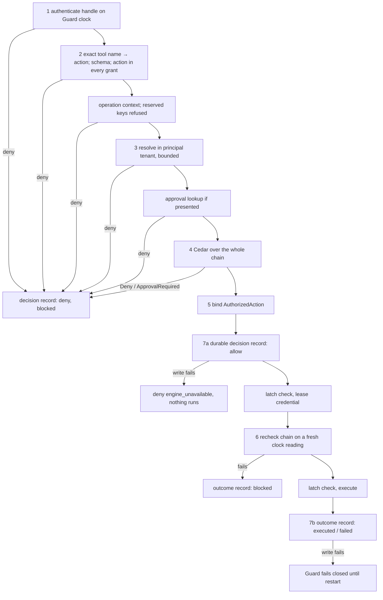

# Enforcement pipeline and operation registry

[#351](https://github.com/mfaulk/crom-rs/issues/351). Spec: [MILESTONE_18](../milestones/MILESTONE_18.md) §9.2 (fail-closed rules), §10.2 (steps 1–8), §12 (audit). Code: `crates/crom-guard/src/pipeline.rs` (`Guard`) and `registry.rs` (`OperationRegistry`).

Every protected call goes through `Guard::call(bearer, tool, arguments, CallMeta) -> CallOutcome`. An executor receives only an `AuthorizedAction`, and only this pipeline builds one, from an `Allow` decision in the same call.

## Wiring

```rust
let mut registry = OperationRegistry::new();
for op in crom_guard_testkit::operations(&api, &SupportConfig::new(url))? {
    registry.register(Arc::new(op))?;
}
registry.register_delegate()?; // optional: agents may attenuate (grants.md)
let store = Arc::new(MemoryGrantStore::new(GrantStoreConfig::new(registry.action_ids())));
let guard = Guard::new(
    registry,
    store.clone(),
    Arc::new(CedarPdp::from_files("Support", schema_path, policy_path)?),
    Arc::new(FileCredentialBroker::open(creds_path)?),
    Arc::new(FileAuditSink::open(audit_path)?),
    Arc::new(SystemClock),
)
.with_resolve_timer(move || Box::pin(tokio::time::sleep(timeout))); // optional
let outcome = guard.call(bearer, "refund.issue", args, CallMeta::default()).await;
```

`Guard` has no async runtime dependency. It awaits the components' futures and nothing else, and `call` returns a `Send` future. `crates/crom-guard/examples/embedded.rs` is a runnable in-process host (`cargo run -p crom-guard --example embedded`). In-process use is for trusted Rust hosts only (ADR 0002 §2.1).

## Steps



| Step | Check | Deny code | `enforcement` |
|---|---|---|---|
| 1 | `SessionHandle::parse`, then `GrantStore::authenticate(handle, clock.now())` | `no_grant`, `grant_not_yet_valid`, `grant_expired`, `grant_revoked` | `guard_session` |
| 2 | Exact, case-sensitive tool-name lookup. No normalization, no aliases | `action_not_granted` (internal reason `unknown_action`) | `guard_validation` |
| 2 | Action listed by every grant in the chain (ADR 0003 §4.3) | `action_not_granted` | `guard_validation` |
| 2 | Serialized size ≤ `MAX_ARGUMENT_BYTES` (64 KiB), object, operation schema | `invalid_arguments` | `guard_validation` |
| 2 | `ProtectedOperation::context` (typed parse). `AuthorizationContext` refuses `grant` and `approval` | the operation's reason, usually `invalid_arguments` | `guard_validation` |
| 3 | Resolver, bounded by any `TimeoutResolver` and by `with_resolve_timer` | `resource_not_found` (missing and other-tenant alike), `engine_unavailable` | `guard_validation`, `guard_policy` |
| — | Presented `approval_id` checked by the `ApprovalVerifier` | `approval_invalid` | `guard_approval` |
| 4 | `PolicyDecisionPoint::authorize` (every grant, fail-closed rules of §9.2) | `policy_deny`, `policy_error`, `chain_deny`; `approval_required` | `guard_policy`, `guard_chain`, `guard_approval` |
| 5 | `AuthorizedAction::bind` returns `None` for anything but `Allow` | — | — |
| 7a | Decision record appended durably | `engine_unavailable` (internal reason `audit_unavailable`) | — |
| 6 | Fail-closed latch, credential lease, `GrantStore::recheck(ctx, clock.now())`, latch again | `engine_unavailable`; `grant_expired`, `grant_revoked` | `guard_session`, `guard_policy` |
| 6 | `ProtectedOperation::execute(AuthorizedAction, CredentialLease)` | failed: `precondition_failed`, `execution_failed` | `executor_precondition` for a precondition |
| 7b | Outcome record appended | — | — |

The recheck runs after the decision record is durable and the credential is leased, so the only work between it and the executor is starting the executor's future.

## Fail-closed rules

- **Time.** `now` comes from the injected `Clock`, read once for authentication and again for the recheck. No request field carries a time.
- **Audit before effect.** The decision record must be durable before the broker or executor is called. An `AuditSink::append` error (for `FileAuditSink`, a write or fsync error such as a full disk) denies. The agent sees `engine_unavailable`, as §12.3 specifies, so it cannot tell that the audit log is down; `tracing` records the internal reason `audit_unavailable`. `ChainedAuditSink` then refuses every later append until restart.
- **Fail-closed latch.** Guard latches (`is_failed_closed()`) when an allowed call may have had an effect with no outcome record. That happens if the outcome record cannot be written, or if the call is cancelled after its decision record (below). The event is logged with `tracing::error!` and to stderr (§12.3). While latched, every call is denied with `engine_unavailable` until the process restarts. The latch is checked on entry, again before the credential lease, and again just before execution, so a call that was already authorized when another call latched Guard does not execute. When the latch is set by a failed outcome write, the call that triggered it still returns its result.
- **Cancellation.** The `call` future is cancel-safe up to the `Allow` decision record. Dropping it earlier leaves Guard serving. Dropping it after that point (during the lease, the recheck, or a pending `execute`) latches Guard, because the effect may already have happened. Hosts must drive every call to completion (e.g. `tokio::spawn` it and await the handle) rather than cancel it on client disconnect or timeout. `crom-guard-server` does this ([server.md](server.md)). Bound downstream calls inside the executor instead.
- **Panics.** Store, resolver, context builder, PDP, approval verifier, broker, sink, and executor calls all run under `catch_unwind`. That covers building the future, polling it, and dropping it, including a drop during cancellation. A panic before execution is a deny (`engine_unavailable`, or `policy_error` from the PDP). A panic in the executor, including one in its future's `Drop` after it returned success, is a `failed` outcome with `execution_failed`, never `executed`. This needs `panic = "unwind"`, the default.
- **Approvals.** `ApprovalRequired` writes a decision record (`decision: approval_required`, `outcome: blocked`) and returns the role and action digest. Nothing executes. After the record is written, `ApprovalVerifier::record_pending` stores the pending request for the admin path ([approvals.md](approvals.md)).
- **Unknown decision kinds.** `Decision` is `#[non_exhaustive]`. Any decision other than `Allow` with a binding is a deny.

## Agent-visible results

`CallOutcome { decision_id, result, audit_head }`. `result` is one of:

| `status` | Fields | Meaning |
|---|---|---|
| `executed` | `content` | The operation's structured output |
| `denied` | `code` | A `DenyReason::code()`. Nothing ran |
| `approval_required` | `role`, `action_digest` | Nothing ran (§9.4) |
| `failed` | `code` | The executor ran and failed: `precondition_failed` or `execution_failed` |

No result carries internal detail. `chain_deny` omits the ancestor grant id, which is only in the audit record. `ExecuteError::Failed` text is never emitted anywhere. The `debug` trace event carries only its length and a 16-hex-digit SHA-256 prefix, for matching against the operation's own logs. Missing and other-tenant resources give byte-identical results apart from `decision_id`. An unknown tool and a registered tool the grant lacks both give `action_not_granted`, and the grant is checked before arguments are validated, so a session cannot enumerate operations or probe their schemas (#405). The audit record keeps `unknown_action` for the former. `audit_head` is the receipt of the last record written for the call, for anchoring (§12.2). The server maps `CallOutcome` to an MCP `CallToolResult` ([server.md](server.md)).

## Audit records

Exactly one `decision` record per call, and at most one `outcome` record, both with the same `decision_id` (`dec-` plus 128 random bits).

- A call denied before execution writes only the decision record, with `decision: deny`, the full `reason`, and `outcome: blocked`.
- An allowed call writes the decision record (`decision: allow`, no `outcome`) and then one outcome record: `executed` (with `downstream_ref` and `execute_us`), `failed`, or `blocked` (recheck or broker failure, with `reason`).
- `args_digest` is the hex SHA-256 of the validated arguments' canonical JSON (the encoding on `ActionDigest::compute`). `args_logged` holds only the operation's `logged_fields`.
- `untrusted` keeps the agent's `tool_use_id` and `client_request_id`, truncated to `MAX_CORRELATION_LEN` (256 bytes), and `client_info` only if it serializes to at most `MAX_CLIENT_INFO_BYTES` (4 KiB). `requested_tool` is set by Guard, and only for an unknown tool name.
- Identity is from the grant chain, and absent if authentication failed.

## Registry

`OperationRegistry::register(Arc<dyn ProtectedOperation>)` rejects:

- a duplicate action id (`RegistryError::Duplicate`);
- an action under `RESERVED_ACTION_PREFIX` (`guard.`), kept for Guard's own operations (`Reserved`);
- any schema outside the keyword allowlist (`InvalidSchema`). Every reachable subschema must be a JSON object with a single `type`, and use only:
  - any type: `title`, `description`, `$comment`, `examples`, `default`, `deprecated`, `readOnly`, `writeOnly`, `enum`, `const`;
  - `string`: `minLength`, `maxLength`, `pattern`, `format`;
  - `integer` / `number`: `minimum`, `maximum`, `exclusiveMinimum`, `exclusiveMaximum`, `multipleOf`;
  - `boolean`, `null`: nothing more;
  - `array`: `items` (required, itself checked), `minItems`, `maxItems`, `uniqueItems`;
  - `object`: `properties` (each checked), `required`, `minProperties`, `maxProperties`, and `"additionalProperties": false` (required).

  The root must be `"type": "object"`, and may also carry `"$schema": "https://json-schema.org/draft/2020-12/schema"`. So boolean and empty (`{}`) subschemas, type unions, arrays without typed `items`, and every applicator other than `properties` and `items` are refused. That includes `allOf`/`anyOf`/`oneOf`, `not`, `if`/`then`/`else`, `contains`, `prefixItems`, `dependentSchemas`, `propertyNames`, `patternProperties`, `unevaluated*`, `$ref` and `$defs`. The schema must then compile as JSON Schema 2020-12. Patterns use the linear-time `regex` engine, and no remote or file reference is ever fetched;
- an unknown `format`. Format **assertion** is on, so a value that does not match its format fails validation. Supported formats: `date-time`, `date`, `time`, `duration`, `email`, `hostname`, `ipv4`, `ipv6`, `uri`, `uri-reference`, `uuid`;
- a `logged_fields` entry that is not a top-level schema property (`UnknownLoggedField`).

`action_ids()` feeds `GrantStoreConfig`. `tools()` lists name, description, and schema for `tools/list`.

## Extension points

- **`ApprovalVerifier` (#354).** Sealed, because only this crate builds an `ApprovalContext`. The default, `NoApprovals`, rejects every presented approval; `MemoryApprovalStore` is the real one ([approvals.md](approvals.md)). Install it with `Guard::with_approval_verifier`. After resolution, the pipeline computes the action digest from the leaf grant, action, resolved uid, and validated args, reads the clock again, and calls `verify(id, ctx, digest, resource, now)` before Cedar; `resource` lets the verifier pin the resource version. The presented approval is matched and consumed **before** Cedar, the decision record, and the recheck, so a later deny (a `forbid`, a revoked grant, an audit failure) burns it and the application must issue a new one. This is deliberate (fail closed, one atomic check-and-consume); see [approvals.md](approvals.md#single-use-and-consumption-point-decided).
- **Builtin operations (#353).** The crate-internal `BuiltinOperation` trait and `OperationRegistry::register_builtin` register operations under `guard.` that receive the `ExecutionContext` and the `GrantStore`. The only one is `guard.delegate`, which hosts enable with the public `OperationRegistry::register_delegate()` ([grants.md](grants.md#agent-facing-delegation-guarddelegate)). The pipeline runs steps 1–2 (including the closed-schema allowlist and the action-in-every-grant check), then the builtin's synchronous `check(ctx, args, now)` under `catch_unwind`. An `Err` from `check` is a deny decision record with that reason (`policy_deny` for a widening delegation), and nothing runs. On `Ok`, the pipeline writes the `allow` decision record (enforcement `guard_validation`), checks the latch, rechecks the chain, and runs `run` with the same `now` that `check` saw. `run` returns `Err(DenyReason)` when nothing took effect, which becomes an outcome `blocked` with that reason (a panic is `failed`). The outcome record follows. No resolver, credential lease, or Cedar evaluation is involved. #353 added `check` so that a rejected builtin call is recorded as a deny, not as an allow followed by a failure; it is required, not defaulted. There is no separate `ChainEvaluator`: `CedarPdp` already evaluates every grant in the chain (#349).

## Tests

- `crates/crom-guard/tests/pipeline.rs`: each step's failure mode, with counters showing the resolver, broker, and executor did not run. Also: the injected clock, revoke and expiry between authorize and execute, cancellation mid-execute (latches) and before the decision record (does not), a panicking executor-future `Drop`, a latch set by a concurrent call after this call's decision record, the schema-allowlist bypasses, executor error text kept out of `tracing`, a failing `MemorySink` and a `ChainedAuditSink` over full-disk storage, outcome-write failure, panicking resolver, context, and executor, `ApprovalRequired`, registry rejections, and a proptest over arbitrary arguments and tool names (no panic, no execution unless the tool is exact and the arguments are schema-valid).
- `crates/crom-guard/src/pipeline.rs` unit tests: the builtin path, including the latch check and a denying or panicking `check`. `registry.rs`: format assertion.
- `crates/crom-guard/tests/attenuation.rs`: `guard.delegate` through the pipeline ([grants.md](grants.md#attenuation-properties-tested)).
- `crates/crom-guard-testkit/tests/pipeline_e2e.rs`: through `SupportOperation::execute` and the HTTP business API. An allowed refund has exactly one ledger effect carrying the decision id. An ownership change or a revoke between authorize and execute leaves no ledger effect. `customer.export` is denied by policy, and still fails closed with no effect under a policy that permits it.
- `crates/crom-guard-testkit/tests/canary.rs`: a canary secret in a `FileCredentialBroker`, across allowed, denied, approval-required, and failed calls. The secret and the session handle appear in no `CallOutcome`, audit line, ledger entry, broker `Debug`, or `tracing` output (captured at `TRACE`).

```sh
cargo test -p crom-guard --test pipeline
cargo test -p crom-guard-testkit --test pipeline_e2e --test canary
cargo run -p crom-guard --example embedded
# E5 in-process latency (release; in-memory sink, so no fsync)
cargo test --release -p crom-guard --test pipeline pipeline_latency -- --ignored --nocapture
```

On the development machine this measured p50 ≈ 67 µs for an allowed call and ≈ 76 µs for a policy deny (the deny also runs the approval probe), without fsync. With `FileAuditSink`, each call adds one or two `fsync`s.
