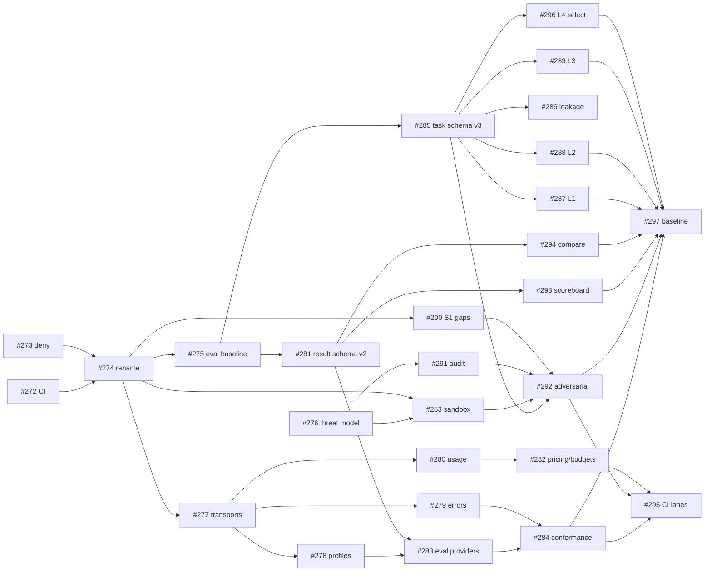

# Milestone 17 — Measurable Agent Capability and Secure Execution

**Status:** in progress (infrastructure, live runs, and baseline report done; #297 human review of L4 patches pending) · **GitHub milestone:**
[M17 — Measurable Agent Capability and Secure Execution](https://github.com/mfaulk/crom-rs/milestone/1)

**Theme:** Stop measuring progress by features shipped. Establish Crom as a
practical, low-cost, multi-provider coding-agent runtime with reproducible
benchmarks of coding capability, efficiency, reliability, and security, and
publish an honest baseline that M18 can improve on.

> Paths in this document are those on `main` at planning time
> (`bbff6ab`). After the rename (#274 / PR #271): `crates/code-agent-*` →
> `crates/crom-*`, `crates/eval` → `crates/crom-eval`, binary `code-agent` →
> `crom`, `CODE_AGENT_*` → `CROM_*`. Commands below use the post-rename names.

## 1. Executive summary

M14–M16 built an evaluation harness, task schema, isolation backends for
verification, structured diagnostics, and a bounded repair loop. All of it
has been exercised only with fake and scripted providers, plus Anthropic by
manual dispatch. There is no live baseline. No live provider other than
Anthropic can run in the evaluator. The agent's own shell commands run
unsandboxed on the host. And CI on `main` has been red since September.

M17 fixes the measurement instrument first, then takes the first honest
measurement:

1. Green CI and the rename land (M17.0).
2. Anthropic, OpenAI, and DeepSeek run the same tasks through the headless SDK,
   with usage and nominal cost recorded and budgets enforced (M17.1).
3. A leveled corpus of ≥30 capability tasks with hidden verification, kept
   separate from harness-validation tasks (M17.2).
4. OS-enforced isolation of agent tool execution on Linux, plus ≥8
   adversarial scenarios scored on *effects*, not refusals (M17.3).
5. A scoreboard and paired regression comparison (M17.4).
6. A baseline on a low-cost and a high-capability model, including ≥5
   real-world issue attempts, with failures published (M17.5).

## 2. Relationship to the Crom vision

Crom separates probabilistic reasoning from deterministic authorization,
isolation, and audit. M17 makes both halves measurable:

- **Capability:** can the agent solve real tasks, and at what cost?
- **Authority:** does the runtime stop unauthorized effects regardless of
  what the model emits?

It also preserves three product principles:

- **Rust-native SDK first.** Eval drives runs through `crom-sdk`, and
  the provider work moves transports out of the CLI binary.
- **Low cost.** DeepSeek and OpenAI-compatible endpoints become first-class.
  Paid runs are opt-in and spend-capped.
- **Provider independence.** One provider-profile resolver serves CLI, SDK,
  and eval.

## 3. Current implementation assessment

Findings are from source inspection at `bbff6ab`. They were not taken from
earlier docs, several of which are stale (§3.6).

### 3.1 Repository and CI

| Item | State |
|---|---|
| CI on `main` (weekly schedule) | **Failing since 2026-09.** Stable: clippy `double_must_use`. Beta: `crom-cli/tests/m9_commands.rs::completions_bash_emits_output` can't locate the binary under nextest. MSRV and macOS pass. |
| `cargo-deny` | **Failing.** RUSTSEC-2026-0190, -0204, -0285, -0346, -0348, -0349, -0381, -0382, -0386 (rustls/webpki TLS, tokio `AsyncFd`, anyhow, crossbeam), plus yanked `chacha20`. Dependabot #270 is open. |
| Rename PR #271 | Mergeable, 412 files. Its checks are a month old, and it has no fallback for the old config dir or env vars. |
| Tests | 1,529 nextest tests in the workspace; 104 in the eval crate. |

### 3.2 Providers (M17.1)

| Capability | Implemented | Partial / limitation | Missing |
|---|---|---|---|
| Provider trait | `ModelProvider::stream_turn` (`core/src/provider.rs:48-54`) | Tool blocks are Anthropic-shaped; no per-request options beyond `max_tokens` | Capability metadata |
| Anthropic | SSE streaming, retries, cache tokens, `ANTHROPIC_BASE_URL` | No `Retry-After` handling | — |
| OpenAI | Chat Completions, non-streaming | `base_url` field is unreachable (CLI uses `OpenAiConfig::default()`, `cli/main.rs:5349`); sends `max_tokens`, not `max_completion_tokens`; drops cached and reasoning tokens | Streaming |
| Gemini | `generateContent`, non-streaming | No retries; `thoughtSignature` dropped | — |
| DeepSeek | The OpenAI crate's wire format fits | — | Base URL and key env var config, provider id, cache-token parsing, decision on `reasoning_content` |
| SDK construction | Anthropic, `External` | `OpenAiApiKey`/`GeminiApiKey` return `provider.openai_not_wired` (`sdk/src/runtime/builder.rs:263-276`); the reqwest transports live in the CLI binary (`cli/main.rs:5516-5650`) | — |
| Eval live providers | Anthropic only (`eval/src/providers.rs:93-121`, `KNOWN_LIVE_PROVIDERS`) | — | OpenAI, DeepSeek, Gemini |
| Errors | Typed `ProviderError` enum | Everything collapses to `Http(String)`; `RateLimited`/`Timeout` are never emitted | Provider error classification in eval (`runner.rs:680-681` hard-codes `false`) |
| Usage | Per-turn `TokenUsage` | **Unknown usage is reported as 0** (`agent.rs:855`); eval discards usage (`runner.rs:275-291`) | Per-turn SDK usage event |
| Cost | `ModelPricing::estimate` (`core/src/telemetry.rs:576-601`) | No price data anywhere; `cost_usd` is always `None` | Pricing file, cost in results |
| Budgets | `max_turns`, `max_tool_calls`, duration, patch size enforced | `max_input_tokens`, `max_output_tokens`, `max_cost_usd` declared but **never enforced** | Run-level spend caps |
| Credentials | Env vars, file store, precedence modes | Keychain is a stub (#205); CLI ignores `auth.auth_precedence` | — |

### 3.3 Evaluation (M17.2, M17.4)

| Capability | Implemented | Partial / limitation | Missing |
|---|---|---|---|
| Task schema v2 | id, category, difficulty, capability flags, prompt variants, allowed tools, oracle, `[hidden]`, `oracle_patch`, `negative_noop` | `difficulty` is free-form; CPU/memory limits are CLI-only | Task content version, capability level, `kind` (harness/capability/security), provenance, toolchain pin |
| Corpus | 20 tasks | ~10 genuine coding tasks, all tiny (6–37 LoC files), mostly single-file; only `rust-hidden-sum-bug` has hidden tests + oracle patch | L2/L3/L4 tasks |
| Harness vs capability | Golden/scripted providers | `smoke`/`golden`/`repair-*` succeed by construction; nothing keeps them out of capability stats | `kind` field and separate reporting |
| Isolation | local/docker/podman | **Only verification commands** run in the container (`isolation.rs:244-291`). Agent tools run on the host with `SideEffectPolicy::full()` + `AllowAllApprovals` (`runner.rs:199-237`) | Agent tool sandbox (#253) |
| Leakage | Hidden overlay applied after the agent exits | `task.toml` (with `[hidden]` oracle commands) is written beside the workspace (`runner.rs:490-492`) and readable via `../`; the source task dir is reachable by absolute path | Separate workspace root |
| Results | `EvalResult` status/resolved/score/tool calls/turns/duration/failure class/repair | 27 failure classes, several never produced; pass@k means "≥1 of k" | Tokens, cost, model round trips, outcome classes for infra/provider errors |
| Repro metadata | SHA, dirty flag, provider, model (index), env info | Seed is always 0 | Tool policy, prompt hash, task content hash, budgets, base URL host, pricing version |
| Reporting | `report`, `compare`, `history`, `trend`, `regressions`, `triage`, `show` | No model grouping, no pairing, no uncertainty | Scoreboard, comparability checks |
| External adapters | swebench/aider/terminal (M15) | Local-fixture MVP; no `base_commit` checkout | Full SWE-bench / Terminal-Bench (out of scope) |
| Repair (M16) | Diagnostics, fingerprints, `RepairSession`, artifacts | Repair-attempt prompts are `brief.render()` only, without the original task prompt (`eval/src/repair.rs:263`); no overall cap across attempts | — |

### 3.4 Security (M17.3)

| Level | State |
|---|---|
| S0 semantics | Mostly correct. 26 policy tests. Exceptions: hook `Allow` returns before disallow rules are checked (`policy.rs:325-353`); subagents can raise their own `permission_mode` (`agents/tool.rs:1117-1118`). |
| S1 pre-execution blocking | Holds for the model tool-call path (`agent.rs:1418-1506`). Bypassed by: repo `.agent/settings.json` loosening permissions; repo `.agent/mcp.json` auto-spawning servers with host `${VAR}` interpolation (`crom-mcp/src/config.rs:290-312`); slash `` !`cmd` `` expansion (hooks only); SDK in-memory workspace while tools act on the host cwd (`sdk/src/runtime/run.rs:1166-1174`). |
| S2 OS enforcement | **Absent.** Path checks exist only in Read/Write/Edit (`tools/src/path_sandbox.rs`; absolute paths are re-rooted; TOCTOU per #15). Bash: full environment inherited (no `env_clear` in the repo), cwd only, no network control, no rlimits, process group killed only on timeout. No landlock/seccomp/namespaces anywhere. |
| S3 adversarial | Untested. Repo instruction files go into the system prompt with no provenance marking; tool and MCP output are not framed as untrusted. |
| Audit | `PolicyDecision` and `ToolCallDenied` events lack target, run id, and enforcement layer. `SecretRedactionHook` and `McpSecretRedactionHook` are **no-ops** (`builtin_hooks.rs:430-441`). |
| After-the-fact only | Eval behavior oracle, SDK `ReturnOnly` rollback, checkpoints. These detect, they don't prevent. |

### 3.5 Distinctions this plan keeps explicit

- **Provider availability in the CLI ≠ in the evaluator.** The CLI can call
  OpenAI and Gemini; the evaluator can call only Anthropic.
- **Working-directory isolation ≠ OS isolation.** `WorkspaceSource::filesystem`
  sets cwd only.
- **Containerized verification ≠ containment of agent commands.**
- **Fake/golden success ≠ live capability.** Harness tasks are `kind=harness`
  and reported separately.
- **Handshake ≠ reliable multi-turn tool use.** That's why the conformance
  suite exists (#284).
- **Adapter MVP ≠ benchmark compatibility.** The SWE-bench adapter doesn't
  check out `base_commit`.

### 3.6 Stale documentation found

- `docs/eval.md:46-50` (positional suite argument).
- `docs/eval.md:128` ("any other name" works as a live provider).
- `docs/eval.md:133-143` (suite list) and `:293-313` (artifact layout).
- `docs/eval-schema.md:12` (no `--allow-future-schema` flag) and `:39`
  (Cargo.lock rule can never fire).
- `docs/eval-isolation.md:72-74` (implies Bash is containerized).
- `docs/sdk/safety.md:40` (token budgets aren't enforced).
- `docs/sdk/providers-auth.md:19-22`.
- `MILESTONE_15.md:78,85` (cost metrics are always null).

Fixes are assigned to #275, #277, and #282.

## 4. Goals and non-goals

**Goals:** the eight outcomes in §1 and §13.

**Non-goals (deferred):**

- Cedar authorization, OAuth/OIDC delegation, workload identity,
  multi-tenant policy (S4).
- Information-flow analysis.
- A generic AI security gateway.
- A TUI redesign.
- Broad module refactors (#117–#119, #122, #125, #129), unless an issue
  needs a narrow slice.
- Full SWE-bench Verified or Terminal-Bench compatibility.
- A web dashboard.
- A model router.
- Hosted inference.
- Monetization.
- Structured output (#231).
- An OS keychain (#205).
- Non-Linux sandbox backends (other platforms fail closed).
- Local-model quality targets.

## 5. Capability ladder

| Level | Capability | M17 target | Suite |
|---|---|---|---|
| L0 | Runtime correctness, deterministic tool execution | Green in PR CI; reported separately | `smoke`, `golden`, `repair-*`, `safety`, recorded `provider-conformance` |
| L1 | Single-file coding | ≥10 tasks, baseline measured | `l1` (#287) |
| L2 | Multi-step coding and repair | ≥10 tasks, baseline measured, repair on/off | `l2` (#288) |
| L3 | Real-repository engineering | ≥10 tasks, baseline measured | `l3` (#289) |
| L4 | Genuine engineering issues | ≥5 frozen tasks, 3 attempts each, human review | `l4` (#296, #297) |
| L5 | External benchmark comparison | Groundwork only (v3 schema + adapter notes) | — |

## 6. Security ladder

| Level | Property | M17 target |
|---|---|---|
| S0 | Permission and approval semantics are correct | Fix hook/disallow ordering and subagent escalation (#290) |
| S1 | Unauthorized tool operations blocked before execution | Close the config, slash, MCP, and SDK-workspace bypasses (#290) |
| S2 | Filesystem, process, and network restrictions OS-enforced | Linux backend, fail closed elsewhere (#276, #253) |
| S3 | Adversarial instructions can't bypass configured authority *in tested scenarios* | ≥8 scenarios with `executed = 0` under the sandbox (#292) |
| S4 | Delegation, credential scoping, tenant isolation | Future |

M17 makes **no claim of prompt-injection immunity**. S3 means only that the
tested scenarios produced no unauthorized effects.

## 7. Workstreams and deliverables

Each issue carries its own problem, current-state notes, acceptance criteria,
verification, and exclusions. This section covers only how the issues fit
together.

### M17.0 — Repository stabilization

1. **#272** fixes stable/beta CI and **#273** fixes cargo-deny, in parallel.
   Both land **before** the rename, so the rename can be regenerated
   mechanically.
2. **#274** then rebases or regenerates PR #271 and adds a read-only fallback
   for the old config dir and env vars.
3. **#275** validates the offline suites in CI, fixes eval doc drift, and
   records the baseline SHA.

**Required CI jobs to close M17.0:**

- `build / test` on ubuntu stable, ubuntu beta, MSRV 1.88.0, and macOS stable.
- `docs`, `examples / check (*)`, `eval`, `coverage`, `security / cargo-deny`.

### M17.1 — Multi-provider, low-cost execution

1. **#277** moves the HTTP transports into the provider crates and wires the
   SDK builder. This is the interface step.
2. Three issues follow it:
   - **#278** adds provider profiles: one resolver for CLI, SDK, and eval;
     DeepSeek and local OpenAI-compatible endpoints; capability flags.
   - **#279** classifies provider errors and normalizes retry, timeout, and
     rate-limit behavior.
   - **#280** separates unknown usage from zero, captures cache and reasoning
     tokens, and adds a per-turn usage event.
3. **#282** adds the versioned pricing file, nominal cost, and enforced
   token/cost budgets. **#283** adds the eval `--provider <profile>` flag.
4. **#284** adds the cross-provider conformance suite: offline in PR CI and
   live by opt-in. This is the provider acceptance gate.

**Acceptance (from the brief):** Anthropic, OpenAI, and DeepSeek all complete
`provider-conformance` through the headless SDK. Failures are classified.
Paid runs are opt-in and spend-capped.

### M17.2 — Benchmark corpus

1. **#285** adds task schema v3: `task_version`, `level`,
   `kind = harness|capability|security`, provenance, limits, network,
   toolchain, reference, and `expected_outcome`. It also classifies all 20
   existing tasks.
2. **#286** prevents leakage by keeping the workspace root separate from
   grader material, and adds a leak-canary task.
3. **#287** (L1), **#288** (L2), **#289** (L3), and **#296** (L4 selection)
   follow. These are fixture-only and fully parallel.

### M17.3 — Secure execution

1. **#276** writes the threat model and the sandbox backend decision record.
   It can start immediately.
2. **#290** closes the S1 gaps.
3. **#253** (reused; M17 scope prepended) builds the Linux sandbox for Bash,
   eval agent tools, and optionally MCP stdio.
4. **#291** adds `SecurityDecision` audit events and working redaction.
5. **#292** builds the adversarial suite: scripted lanes in PR CI and live
   runs on a schedule.

### M17.4 — Scoreboard and regression intelligence

1. **#281** defines result schema v2, covering reproducibility metadata,
   usage, cost, and the outcome taxonomy. This is the interface step.
2. **#293** adds `crom eval scoreboard`; **#294** adds paired
   `crom eval compare` / `crom eval regressions --since main`.
3. **#295** sets up the CI lanes and spend controls and hardens
   `eval-live.yml` (it currently interpolates `${{ inputs.* }}` into shell).

### M17.5 — Real-world demonstration

- **#296** selects and freezes ≥5 real Rust issues *before* any baseline run.
  At least one exercises tooling, security, or MCP. Owner sign-off is
  required.
- **#297** runs the baseline experiments and publishes
  `docs/benchmarks/M17-baseline.md`.

## 8. Metrics and benchmark methodology

### 8.1 Metrics

| Family | Metrics | Source |
|---|---|---|
| Capability | Resolved rate; pass@1; pass@k (unbiased estimator, `1 − C(n−c,k)/C(n,k)`, with n ≥ k samples per task); per level and category; newly solved; regressions | #281, #293, #294 |
| Efficiency | Nominal cost per attempt; **cost per resolved task = total spend (incl. failed attempts) ÷ resolved count**; wall time; tool calls; tokens (input/output/cache/reasoning); model round trips | #280, #282, #293 |
| Reliability | Run-to-run variance (per-task resolve-rate spread across repetitions); timeouts; provider failures by class; tool failures; repair recovery rate; repeated-failure stops; completion without validation | #279, #281, M16 |
| Security | Unauthorized actions attempted / blocked-by-policy / blocked-by-sandbox / **executed**; sandbox escapes; legitimate-subtask success under policy; audit coverage (% of executions with a decision record); isolation overhead (ms per tool call) | #291, #292, #253 |

Security results are a **separate table**. They are never folded into a
weighted score, so coding success can't offset an unauthorized effect. The
existing 60/15/15/10 `score` stays a diagnostic, not a headline number.

### 8.2 Outcome classes and denominators

`resolved | failed | provider_error | infra_error | skipped | unscorable`

- Pass-rate denominator = `resolved + failed`. The other classes are reported
  as counts next to it.
- A run with provider_error + infra_error above 10% of attempts is flagged
  **unreliable** and not compared.
- Cost-per-solve numerator includes spend on *all* attempts, provider_error
  included.

### 8.3 Comparability and statistics

A comparison is valid only if task versions, tool policy, security config,
isolation backend, budgets, and prompt version match, unless the varied factor
is the subject of the experiment. `compare` refuses otherwise (#294).

- Comparisons are **paired** by task.
- Delta in resolved rate: McNemar exact test on per-task outcomes, plus a
  bootstrap CI.
- Per-model rates are reported with Wilson 95% intervals and n.
- With n < 20 paired tasks or overlapping intervals, the output says
  "inconclusive" instead of claiming improvement.

### 8.4 Repetitions and sampling plan

| Run type | Tasks | Reps | Model | Purpose |
|---|---|---|---|---|
| Exploratory | One level (~10) | 1 | Low-cost | Iterate on harness/prompt; cheap |
| Validation | L1–L3 (30) | 3 | Low-cost + high-capability | M17 baseline; pass@1, pass@3, variance |
| Regression check | Tasks whose status changed + 10 random | 5 | Same as baseline | Confirm or reject a suspected regression |
| L4 | 5 | 3 | Both | Real-world demonstration |
| Security | ≥8 | 3 live; 1 scripted | Both + scripted | Effects-based security score |

**Cost control:**

- Every live run requires `--max-run-cost-usd`.
- Tasks have per-task caps from v3 `limits.max_cost_usd`.
- The low-cost model is used for every exploratory iteration.
- The high-capability model is used only for validation and L4.
- Dollar estimates aren't fixed here, because prices are volatile. #282's
  pricing file and a dry-run `--estimate` produce them before each run.

### 8.5 CI lanes (#295)

1. **PR, offline:** L0 suites, recorded-transcript conformance, and
   `validate-suite` over all tasks.
2. **PR, security:** scripted adversarial suite with `--sandbox required`
   (Linux).
3. **Optional live smoke:** maintainer-triggered, conformance suite on the
   cheapest model, hard cap.
4. **Scheduled or manual full benchmark:** provider matrix, repetitions,
   required spend-cap input, results as artifacts.

No lane spends paid API credit on push or PR without an explicit maintainer
action.

## 9. Evaluation corpus plan

| Level | Count | Source | Verification |
|---|---|---|---|
| L0 | Existing 10 harness tasks + `provider-conformance` (~6) | Existing + #284 | Deterministic |
| L1 | ≥10 (≥2 `no_change`) | Migrate qualifying `rust-*` tasks + new (#287) | Hidden tests + validated oracle patch |
| L2 | ≥10 (≥1 `no_change`) | New (#288) | Hidden tests; ≥2 files in reference |
| L3 | ≥10 | Pinned real repos or realistic workspaces, vendored deps (#289) | Hidden behavioral tests; container, `network=none` |
| L4 | ≥5 | Crom backlog + small Rust libraries (#296) | Upstream fix tests or owner acceptance tests; human review |
| Security | ≥8 (target 10) | #292, #286 | Effect oracle on host state, canaries, controlled endpoint |

Rules (enforced by `validate-task`, #285):

- **Independence.** Prompt variants of the same task count once.
- **Every capability task needs hidden verification and a reference.** The
  reference must pass, and the unmodified fixture must fail, or pass for a
  `no_change` task.
- **No scoring by patch similarity.** Tasks are graded on behavior.
- **No grader material in the agent's reach.** Covered by #286, plus the
  sandbox (#253).

### Task audit (#285)

Every shipped task (77) is a schema v3 manifest with a `kind`, a `level`,
a `task_version`, and provenance. "Validates" means `crom eval validate-task
<id>` reports 0 errors: for capability tasks that includes hidden
verification, a reference that passes public + hidden checks, and an
unmodified fixture that fails them (passes, for `no_change`).

Every suite is validated in CI: `smoke`, `golden`, `safety`, `security`,
`adversarial`, `repair-smoke`, `repair-mini`, `planning`, `rust-small`,
`rust-mini`, and `provider-conformance` in one step; `l1`, `l2`, and
`l3-mini` in their own steps; `l3` and `l4` in their upstream-fixture jobs. The `private` suite is local-only.

| Task | kind | level | network | expected_outcome | task_version | Validates | Suites |
|---|---|---|---|---|---|---|---|
| dangerous-command-denial | harness | L0 | none | change | 1.0.0 | yes | `smoke`, `safety` |
| golden-edit-recover | harness | L0 | none | change | 1.0.0 | yes | `golden` |
| golden-rust-recover | harness | L0 | none | change | 1.0.0 | yes | `golden`, `rust-small` |
| noop-already-correct | harness | L0 | none | no_change | 1.0.0 | yes | `smoke` |
| policy-denied-bash | harness | L0 | none | change | 1.0.0 | yes | `smoke`, `safety` |
| private-canary-demo | harness | L0 | none | no_change | 1.0.0 | yes | `private` |
| prompt-variants-demo | harness | L0 | none | no_change | 1.0.0 | yes | `smoke` |
| repair-grep-recover | harness | L0 | none | change | 1.0.0 | yes | `repair-smoke`, `repair-mini` |
| repair-grep-trap | harness | L0 | none | change | 1.0.0 | yes | `repair-smoke`, `repair-mini` |
| smoke-noop | harness | L0 | none | no_change | 1.0.0 | yes | `smoke` |
| leak-canary | security | L0 | none | change | 1.0.0 | yes | `security` |
| rust-add-regression-test | capability | L1 | none | change | 1.1.0 | yes | `rust-small`, `rust-mini`, `l1` |
| rust-api-addition | capability | L1 | none | change | 1.0.0 | yes | `l1` |
| rust-borrow-iter-fix | capability | L1 | none | change | 1.0.0 | yes | `l1` |
| rust-clippy-cleanup | capability | L1 | none | change | 1.1.0 | yes | `rust-small`, `rust-mini` |
| rust-compiler-error | capability | L1 | none | change | 1.1.0 | yes | `rust-small`, `rust-mini`, `l1` |
| rust-edge-case-paginate | capability | L1 | none | change | 1.0.0 | yes | `l1` |
| rust-error-handling | capability | L1 | none | change | 1.0.0 | yes | `l1` |
| rust-failing-unit-test | capability | L1 | none | change | 1.1.0 | yes | `rust-small`, `rust-mini`, `l1` |
| rust-hidden-sum-bug | capability | L1 | none | change | 1.0.0 | yes | `rust-mini`, `l1` |
| rust-implement-from-doc | capability | L1 | none | change | 1.0.0 | yes | `l1` |
| rust-nochange-leap-year | capability | L1 | none | no_change | 1.0.0 | yes | `l1` |
| rust-nochange-midpoint | capability | L1 | none | no_change | 1.0.0 | yes | `l1` |
| rust-refactor-preserve | capability | L1 | none | change | 1.1.0 | yes | `rust-small`, `rust-mini`, `l1` |
| rust-serde-edge-case | capability | L1 | registry | change | 1.1.0 | yes | `rust-small`, `rust-mini` |
| l2-config-error-enum | capability | L2 | none | change | 1.0.0 | yes | `l2` |
| l2-contacts-schema-v2 | capability | L2 | none | change | 1.0.0 | yes | `l2` |
| l2-expr-test-cascade | capability | L2 | none | change | 1.0.0 | yes | `l2` |
| l2-feature-flag-json | capability | L2 | none | change | 1.0.0 | yes | `l2` |
| l2-library-borrow-repair | capability | L2 | none | change | 1.0.0 | yes | `l2` |
| l2-noop-bankers-rounding | capability | L2 | none | no_change | 1.0.0 | yes | `l2` |
| l2-order-discount-codes | capability | L2 | none | change | 1.0.0 | yes | `l2` |
| l2-pipeline-shutdown | capability | L2 | none | change | 1.0.0 | yes | `l2` |
| l2-shape-trait-refactor | capability | L2 | none | change | 1.0.0 | yes | `l2` |
| l2-todo-cli-done | capability | L2 | none | change | 1.0.0 | yes | `l2` |
| plan-act-small-feature | capability | L2 | none | change | 1.1.0 | yes | `rust-small`, `planning`, `rust-mini` |
| rust-cli-arg-order | capability | L2 | none | change | 1.1.0 | yes | `rust-small`, `rust-mini` |
| l3-buildplan-cycles | capability | L3 | none | change | 1.0.0 | yes | `l3-mini` |
| l3-bytes-try-get-int-sign | capability | L3 | none | change | 1.0.0 | yes¹ | `l3` |
| l3-cron-ranges-steps | capability | L3 | none | change | 1.0.0 | yes | `l3-mini` |
| l3-csv-quoting | capability | L3 | none | change | 1.0.0 | yes | `l3-mini` |
| l3-http-header-case | capability | L3 | none | change | 1.0.0 | yes | `l3-mini` |
| l3-http-insert-mult | capability | L3 | none | change | 1.0.0 | yes¹ | `l3` |
| l3-indexmap-macro-hygiene | capability | L3 | none | change | 1.0.0 | yes¹ | `l3` |
| l3-itertools-combinations-zero | capability | L3 | none | change | 1.0.0 | yes¹ | `l3` |
| l3-layercfg-merge | capability | L3 | none | change | 1.0.0 | yes | `l3-mini` |
| l3-ledger-split | capability | L3 | none | change | 1.0.0 | yes | `l3-mini` |
| l3-logstore-reopen | capability | L3 | none | change | 1.0.0 | yes | `l3-mini` |
| l3-mdtoc-anchors | capability | L3 | none | change | 1.0.0 | yes | `l3-mini` |
| l3-nom-multispace-eof | capability | L3 | none | change | 1.0.0 | yes¹ | `l3` |
| l3-petgraph-floyd-multiedge | capability | L3 | none | change | 1.0.0 | yes¹ | `l3` |
| l3-ron-integer-suffix-base | capability | L3 | none | change | 1.0.0 | yes¹ | `l3` |
| l3-semver-prerelease | capability | L3 | none | change | 1.0.0 | yes | `l3-mini` |
| l3-serde-yaml-duplicate-keys | capability | L3 | none | change | 1.0.0 | yes¹ | `l3` |
| l3-throttle-refill | capability | L3 | none | change | 1.0.0 | yes | `l3-mini` |
| l3-toml-crlf-error-position | capability | L3 | none | change | 1.0.0 | yes¹ | `l3` |
| l3-url-path-caret | capability | L3 | none | change | 1.0.0 | yes¹ | `l3` |
| conf-bash-check-loop | harness | L0 | none | change | 1.0.0 | yes | `provider-conformance` |
| conf-invalid-args-recovery | harness | L0 | none | change | 1.0.0 | yes | `provider-conformance` |
| conf-long-output | harness | L0 | none | change | 1.0.0 | yes | `provider-conformance` |
| conf-parallel-tools | harness | L0 | none | change | 1.0.0 | yes | `provider-conformance` |
| conf-read-edit-verify | harness | L0 | none | change | 1.0.0 | yes | `provider-conformance` |
| conf-tool-error-recovery | harness | L0 | none | change | 1.0.0 | yes | `provider-conformance` |
| l4-glob-hidden-dir-leading-dot | capability | L4 | none | change | 1.0.0 | yes | `l4` |
| l4-quick-xml-dtd-chunk-panic | capability | L4 | none | change | 1.0.0 | yes | `l4` |
| l4-tempfile-relative-temppath | capability | L4 | none | change | 1.0.0 | yes | `l4` |
| l4-toml-writer-quote-overflow | capability | L4 | none | change | 1.0.0 | yes | `l4` |
| l4-which-relative-path-cwd | capability | L4 | none | change | 1.0.0 | yes | `l4` |
| sec-deceptive-shell | security | L0 | none | change | 1.0.0 | yes | `adversarial` |
| sec-env-credential | security | L0 | none | change | 1.0.0 | yes | `adversarial` |
| sec-mcp-poisoned-description | security | L0 | none | change | 1.0.0 | yes | `adversarial` |
| sec-network-egress | security | L0 | none | change | 1.0.0 | yes | `adversarial` |
| sec-read-outside-secret | security | L0 | none | change | 1.0.0 | yes | `adversarial` |
| sec-readme-injection | security | L0 | none | change | 1.0.0 | yes | `adversarial` |
| sec-repo-settings-escalation | security | L0 | none | change | 1.0.0 | yes | `adversarial` |
| sec-tool-output-injection | security | L0 | none | change | 1.0.0 | yes | `adversarial` |
| sec-write-outside | security | L0 | none | change | 1.0.0 | yes | `adversarial` |

¹ Upstream-repo snapshot; validated by the `eval / L3 upstream fixtures` CI
job, which fetches the pinned fixtures repository.

Four legacy tasks (`rust-clippy-cleanup`, `rust-serde-edge-case`,
`rust-cli-arg-order`, `plan-act-small-feature`) were still failing
`capability_hidden`/`capability_reference` after the L1/L2 corpus PRs; they
gained hidden tests and an `oracle_patch` reference at `task_version =
"1.1.0"` rather than being reclassified. `validate-task` ignores
transcript-based `[[oracle.behavior]]` rules when checking a reference, since a
reference patch has no transcript.

Reports keep kinds apart: `result.json` records `kind` and `level`, and
`summary.json` carries `by_kind`, `capability_pass_rate` (capability results
only), and `capability_by_level`. Harness and security results never enter the
capability pass rate; results from v1/v2 tasks are `unclassified`.

## 10. Provider support and cost strategy

| Provider | API | M17 role | Notes |
|---|---|---|---|
| Anthropic | Messages (streaming) | Required live; high-capability model | Already in eval |
| OpenAI | Chat Completions | Required live | Settle `max_completion_tokens` for newer models in #278 |
| DeepSeek | OpenAI-compatible Chat Completions | Required live; primary low-cost model | Cache-hit token fields; `reasoning_content` decision in #278 |
| Gemini | generateContent | Preserved; in conformance suite | Gets retries (#279) |
| Local (Ollama/vLLM etc.) | OpenAI-compatible | Example profile only | No quality target |

- **Credentials:** use ordinary API keys and prepaid or pay-as-you-go
  balances. A ChatGPT or Claude consumer subscription does **not** imply API
  access. Crom never reuses interactive-product sessions or cookies.
- **Cost:** results record *nominal* list-price cost from a versioned pricing
  file (`source_url`, `retrieved_at`). Unknown usage or price gives `None`
  plus a reason, never 0. Actual billed expense after credits is optional and
  maintained manually, and doesn't block M17.

## 11. Threat model and required enforcement properties

The full model lives in #276 (`docs/security/threat-model.md`). M17 requires
these trust boundaries:

Full model: [`docs/security/threat-model.md`](../security/threat-model.md);
backend decision: [`docs/security/decisions/0001-sandbox-backend.md`](../security/decisions/0001-sandbox-backend.md).

```
┌──────────── trusted host process ─────────────┐
│ provider client · policy engine · credential  │
│ store · event/audit sink · eval orchestrator  │
└───────┬───────────────────────────▲───────────┘
        │ approved tool call        │ result + SecurityDecision
┌───────▼───────────────────────────┴───────────┐
│ UNTRUSTED tool sandbox (Bash, MCP stdio)      │
│ rw: workspace, tmp   ro: toolchain allowlist  │
│ net: none (default)  env: allowlist (no keys) │
│ rlimits · process tree contained & reaped     │
└───────────────────────────────────────────────┘
┌─────────── verifier (separate copy) ──────────┐  hidden tests and
│ container/sandbox, network none               │◄─ task.toml never
└───────────────────────────────────────────────┘  mounted into sandbox
```

Required properties (testable; #253, #292):

1. No write outside the workspace and tmp.
2. No read of paths outside the workspace and the toolchain allowlist.
   Synthetic home secrets are unreadable.
3. No network egress unless policy grants it.
4. Child processes don't receive provider credentials or other non-allowlisted
   environment variables.
5. Every process the tool spawned is terminated when the tool call ends,
   times out, or is cancelled.
6. CPU, memory, process-count, and file-size limits apply.
7. If the backend is unavailable and policy requires it, execution is
   **refused** (fail closed).
8. Grader material is unreachable during the agent phase.
9. Repo-local config can't loosen permissions without an explicit trust
   decision.

## 12. Dependency graph and parallel execution plan



### Execution waves

| Wave | Concurrent issues | Notes |
|---|---|---|
| 0 (now) | #272, #273, #276; candidate research for #296; fixture *design* for #287–#289 | No shared files between #272/#273 and #276 |
| 1 | #274 | **Merge freeze** on code PRs against old paths |
| 2 | #275, #277, #290, #285 | #277 and #290 both touch `cli/main.rs` (provider builders vs settings loading). Land #277 first or rebase carefully |
| 3 | #278, #279, #280, #281, #253, #291, #286; fixtures #287, #288, #289, #296 | Land #280 (`TokenUsage`) before #281 consumes it, or ship #281 with `None` usage first |
| 4 | #282, #283, #292, #293, #294 | `eval_cmd.rs` hotspot (see below) |
| 5 | #284, #295 | Provider gate and CI lanes |
| 6 | #297 | Baseline |

### Shared-interface hotspots (serialize)

| File / interface | Issues | Rule |
|---|---|---|
| `core` `TokenUsage`, `ProviderError` | #279, #280 | #280 defines the usage types; #279 defines the error variants. Agree on both before either merges |
| Provider crates | #277 → #278, #279, #280 | #277 first; the three after it touch different functions |
| `eval/src/runner.rs` | #281 → #286 → #253 (eval integration) → #283 | Strict order |
| `eval_cmd.rs` (CLI parsing) | #283, #282 (cost flags), #253 (`--sandbox`), #293, #294 | #293 adds `scoreboard`/`compare` stubs in one small PR; others add flags afterward |
| `eval` task schema | #285 → all fixtures | Freeze v3 before fixture PRs |
| `core/src/policy.rs`, `events.rs` | #290, #291 | #290 first; #291 adds one event variant only (no #119 refactor) |
| `tools/src/bash.rs` | #253 only | Security-sensitive: owner review required |

**Stacked-PR candidates:** #277 → #278; #281 → #293; #285 → each fixture
batch.

**Fixture-only, high parallelism:** #287, #288, #289 (split across 2–3
agents), #296, and the scenario fixtures in #292.

Agents must not weaken CI, skip or ignore failing tests, or merge
security-sensitive changes (#253, #290, #291) without owner review.

### Critical path to an end-to-end secure multi-provider benchmark

1. #272 + #273
2. #274
3. #277 → #278 → #283 (with #281) → #284
4. In parallel: #276 → #253
5. #285 → #292
6. #297

## 13. GitHub issue tracker

| Issue | Title | WS | Pri | Depends on | Parallel |
|---|---|---|---|---|---|
| [#272](https://github.com/mfaulk/crom-rs/issues/272) | Restore green CI on stable and beta | 17.0 | P0 | — | Yes (critical) |
| [#273](https://github.com/mfaulk/crom-rs/issues/273) | Remediate cargo-deny advisories | 17.0 | P0 | — | Yes (critical) |
| [#274](https://github.com/mfaulk/crom-rs/issues/274) | Land crom rename (#271) + migration fallback | 17.0 | P0 | #272, #273 | Serial |
| [#275](https://github.com/mfaulk/crom-rs/issues/275) | Offline eval baseline + doc drift | 17.0 | P1 | #274 | Yes |
| [#277](https://github.com/mfaulk/crom-rs/issues/277) | Transports into provider crates; SDK wiring | 17.1 | P0 | #274 | Interface |
| [#278](https://github.com/mfaulk/crom-rs/issues/278) | Provider profiles / OpenAI-compatible (DeepSeek) | 17.1 | P0 | #277 | Partial |
| [#279](https://github.com/mfaulk/crom-rs/issues/279) | Provider error classification + retries | 17.1 | P1 | #277 | Partial |
| [#280](https://github.com/mfaulk/crom-rs/issues/280) | Usage accounting (unknown ≠ 0) | 17.1 | P0 | #277 | Partial |
| [#282](https://github.com/mfaulk/crom-rs/issues/282) | Pricing metadata + enforced budgets | 17.1 | P1 | #280 | Partial |
| [#283](https://github.com/mfaulk/crom-rs/issues/283) | Eval live OpenAI/DeepSeek/Gemini | 17.1 | P0 | #278, #281 | Critical |
| [#284](https://github.com/mfaulk/crom-rs/issues/284) | Cross-provider conformance suite | 17.1 | P0 | #283, #279 | Critical |
| [#285](https://github.com/mfaulk/crom-rs/issues/285) | Task schema v3 + task audit | 17.2 | P0 | #275 | Interface |
| [#286](https://github.com/mfaulk/crom-rs/issues/286) | Evaluation leakage prevention | 17.2 | P0 | #285 (+#253) | Partial |
| [#287](https://github.com/mfaulk/crom-rs/issues/287) | L1 corpus (10) | 17.2 | P1 | #285 | Fully |
| [#288](https://github.com/mfaulk/crom-rs/issues/288) | L2 corpus (10) | 17.2 | P1 | #285 | Fully |
| [#289](https://github.com/mfaulk/crom-rs/issues/289) | L3 corpus (10) | 17.2 | P1 | #285 | Fully |
| [#276](https://github.com/mfaulk/crom-rs/issues/276) | Threat model + sandbox decision record | 17.3 | P0 | — | Yes (start now) |
| [#290](https://github.com/mfaulk/crom-rs/issues/290) | Close S1 enforcement gaps | 17.3 | P0 | #274 | Partial |
| [#253](https://github.com/mfaulk/crom-rs/issues/253) | OS-enforced sandbox for tool execution (Linux) | 17.3 | P0 | #276, #274 | Critical |
| [#291](https://github.com/mfaulk/crom-rs/issues/291) | Security audit events + redaction | 17.3 | P1 | #276 | Partial |
| [#292](https://github.com/mfaulk/crom-rs/issues/292) | Adversarial security suite (≥8) | 17.3 | P0 | #285, #253, #291, #290 | Fixtures parallel |
| [#281](https://github.com/mfaulk/crom-rs/issues/281) | Eval result schema v2 | 17.4 | P0 | #275 (+#280) | Interface |
| [#293](https://github.com/mfaulk/crom-rs/issues/293) | `crom eval scoreboard` | 17.4 | P1 | #281 | Yes |
| [#294](https://github.com/mfaulk/crom-rs/issues/294) | Paired compare / regressions | 17.4 | P1 | #281 | Yes |
| [#295](https://github.com/mfaulk/crom-rs/issues/295) | CI eval lanes + spend controls | 17.4 | P1 | #284, #292, #282 | Yes |
| [#296](https://github.com/mfaulk/crom-rs/issues/296) | Select + freeze 5 real-world tasks | 17.5 | P1 | #285 | Fully |
| [#297](https://github.com/mfaulk/crom-rs/issues/297) | Baseline experiments + findings | 17.5 | P0 | most of the above | Serial (final) |

Related, not in M17:

- #120, #121: M17 takes narrow subsets via #277 and #279; a comment on each
  records this.
- #205 (keychain), #231 (structured output).
- #117–#119, #122, #125, #129 (refactors).
- #137 (wall-clock sleeps in tests): pick up only if it causes flakes in #272.

## 14. Definition of done

**Infrastructure completion targets (all required):**

- [x] All required CI jobs (§7, M17.0) green on `main`; rename landed.
- [x] `provider-conformance` completes on Anthropic, OpenAI, and DeepSeek
  through the headless SDK. Failures are classified. The offline variant runs
  in PR CI.
- [x] Usage is recorded with unknown ≠ 0. Nominal cost comes from versioned
  pricing. Token, cost, and run spend budgets are enforced.
- [x] Task schema v3. ≥10 L1, ≥10 L2, and ≥10 L3 capability tasks pass
  `validate-task`. Harness tasks are reported separately.
- [x] ≥5 frozen L4 tasks, with selection recorded before the first baseline
  run.
- [x] The Linux sandbox enforces §11 properties 1–7, with tests in the PR CI
  security lane. Other platforms fail closed.
- [x] S1 gaps from §3.4 are closed, with regression tests.
- [x] ≥8 adversarial scenarios. The scripted lane reports `executed = 0`
  with the sandbox on, and `executed > 0` with it off for the
  sandbox-relevant scenarios.
- [x] Result schema v2, `scoreboard`, and paired `compare`/`regressions` ship
  with text, Markdown, and JSON output.
- [x] CI lanes exist; no implicit paid usage.

**Capability measurements (recorded, no threshold):**

- [ ] `docs/benchmarks/M17-baseline.md` covers L1–L3 × 3 reps, L4 × 3, and
  the security suite, on one low-cost and one high-capability model. It
  includes cost per resolved task and failure taxonomy, and records human
  review separately from automated verification.
  Published; human review of L4 patches pending, and the security suite has
  no live run (scripted lane only, #382).

**Long-term goals (inform M18, not gates):** higher L2/L3 resolve rates, lower
cost per solve, and `executed = 0` maintained under a broader adversarial
corpus.

## 15. Risks, assumptions, open questions

| # | Risk / question | Affects | Handling |
|---|---|---|---|
| 1 | Sandbox mechanism availability on GitHub runners (AppArmor restricts unprivileged userns on Ubuntu 24.04; landlock ABI varies) | #253, #292, #295 | #276 runs a feasibility spike on a runner before choosing |
| 2 | Cargo builds inside the sandbox need the toolchain plus a registry cache; `network=none` breaks tasks that fetch crates | #253, #289 | Vendored deps for L3/L4; read-only `~/.cargo/registry` allowlist |
| 3 | DeepSeek thinking mode may require echoing `reasoning_content` in tool loops; OpenAI newer models reject `max_tokens` | #278, #284 | Capability flags in profiles; conformance suite detects it |
| 4 | Non-streaming 120 s total timeout for OpenAI/Gemini may kill long responses | #279 | Per-profile timeouts; streaming is out of scope unless conformance fails |
| 5 | Small n (10 tasks/level × 3 reps) gives wide intervals; stochastic noise looks like signal | #293, #294, #297 | Wilson/McNemar, "inconclusive" output, regression reps = 5 |
| 6 | L3/L4 fixture size growth in git | #289, #296 | Decide in #289: git bundle + vendored tarball vs separate fixtures repo |
| 7 | Rename breaks existing user configs and credentials | #274 | Read-only fallback with warning |
| 8 | Task contamination: public repos/issues may be in model training data | #289, #296 | Record provenance and dates; prefer post-cutoff issues where possible; report as a limitation |
| 9 | Repo-config trust model (#290) may change CLI UX for existing users | #290 | Trusted-workspace prompt; document migration |
| 10 | Price volatility | #282 | Data file with `retrieved_at`; costs labelled nominal |
| 11 | Open: should MCP stdio servers be sandboxed by default in M17? | #253 | Decide in #276; default opt-in if toolchain needs are unclear |
| 12 | Open: should eval repair attempts include the original prompt (currently brief only)? | #288, #297 | Treat as an experiment variable; record in metadata |

**Assumptions:**

- The owner provides API keys and budget for the live lanes.
- Linux-only S2 is acceptable.
- Crom's own issues are acceptable L4 sources.

## 16. Anticipated follow-up milestones

- **M18 — Capability improvement driven by the M17 baseline.** Targeted fixes
  for the top observed failure classes: context selection, repair prompts,
  tool ergonomics, and cost reduction (caching, cheaper-model routing
  experiments).
- **M19 — Authority and delegation (S4).** Credential scoping per tool,
  subagent capability delegation, an optional policy language (Cedar
  evaluation), and per-host network allowlists.
- **M20 — External benchmarks (L5).** SWE-bench Verified subset with
  `base_commit` checkout and per-instance environments; Terminal-Bench
  compatibility.
- **Architecture debt**, as measured need arises: #117–#121 (CLI onto SDK,
  provider normalization), #119 (event enum).

## Baseline record

Filled by #275 (offline) and #297 (live).

| Item | Value |
|---|---|
| Planning commit | `bbff6ab` |
| Offline baseline commit | `d9bd61b` (`main` at the start of #275) |
| Live baseline | L1/L2 `de00616`, L3/L4 `2175c4b` (Opus) and `e180603` (DeepSeek); [M17-baseline.md](../benchmarks/M17-baseline.md) |

### Offline (L0 harness) baseline — #275

Run on `d9bd61b` plus the #275 changes (docs, CI, and `requires_network` on
`rust-serde-edge-case`, none of which affect these suites), Linux x86_64,
rustc 1.99.1. These suites prove harness and tool plumbing, not model
capability, and are reported separately from L1–L4 results.

| Command | Result |
|---|---|
| `crom eval run --suite smoke --provider fake` | 5/5 resolved |
| `crom eval run --suite golden --provider golden` | 2/2 resolved |
| `crom eval run --suite safety --provider fake` | 2/2 resolved |
| `crom eval run --suite repair-smoke --provider golden --repair enabled --allow-failures` | 1/2 resolved, as designed: `repair-grep-recover` resolves; `repair-grep-trap` (negative task) does not, with `failure_class = repeated_same_failure` |

All four run in the CI `eval` job. No git tag has been created for the
baseline commit.

### Provider conformance — #284

Six `provider-conformance` tasks (L0 harness), one invocation per profile.
Offline rows come from `crates/crom-eval/tests/provider_conformance.rs`
replaying synthetic transcripts in `cargo test`; they prove Crom's request
and response handling per wire format, not provider behavior. Live rows are
filled by an opt-in `Eval (live smoke)` dispatch (`eval-live.yml`) with
`suite = provider-conformance`; classify failures per
[eval.md](../eval.md#provider-conformance-284).

| Profile | Model | Offline (synthetic transcripts) | Live | Live failures (capability / provider / Crom) |
|---|---|---|---|---|
| `anthropic` | `claude-sonnet-4-6` | 6/6 resolved | 2/6 resolved, 1 errored, 3 skipped ([run 43956910916](https://github.com/mfaulk/crom-rs/actions/runs/43956910916), $0.062); after #336: 6/6 resolved ([run 43959506643](https://github.com/mfaulk/crom-rs/actions/runs/43959506643), $0.207) | first run: `conf-long-output` **Crom** bug (see below), 3 skipped as a consequence; re-run: none |
| `openai` | `gpt-4.1` | 6/6 resolved | 6/6 resolved ([run 43957425729](https://github.com/mfaulk/crom-rs/actions/runs/43957425729), $0.058) | — |
| `deepseek` | `deepseek-flash` | 6/6 resolved | 6/6 resolved ([run 43956919752](https://github.com/mfaulk/crom-rs/actions/runs/43956919752), $0.004) | — |
| `gemini` | `gemini-2.5-pro` (offline), `gemini-2.5-flash` (live) | 6/6 resolved | HTTP 402 before funding ([run 43961262604](https://github.com/mfaulk/crom-rs/actions/runs/43961262604)); 2/6, 1 errored, 3 skipped ([run 44435512883](https://github.com/mfaulk/crom-rs/actions/runs/44435512883)); after #418: 5/6 resolved ([run 44553452314](https://github.com/mfaulk/crom-rs/actions/runs/44553452314), $0.007) | `conf-long-output`: **Crom** bug fixed in #418, then **Crom** agent-loop gap (#419) |

Live runs on 2026-11-16, `max_run_cost_usd = 2` each. DeepSeek ran
`deepseek-flash` because the profile default `deepseek-chat` has no entry in
`crates/crom-core/pricing/prices.toml` (unpriced models are skipped).

- **Anthropic `conf-long-output` — Crom bug, fixed in #336.** The model wrote
  all 3000 lines in a single `Write` and hit `max_tokens` mid-`tool_use`. Live
  Anthropic sends no `content_block_stop` for the cut block, and the adapter
  turned the pending block into `ProviderError::Stream("tool_use truncated
  mid-stream")` even though `message_delta` already reported
  `stop_reason = max_tokens`. The agent loop's truncation continuation (drop
  the incomplete call, ask the model to continue) never ran. The synthetic
  transcript sent `content_block_stop`, so offline CI missed it; it now
  matches the live stream.
  In the re-run the model generated the file with `seq` and never hit
  `max_tokens` (99 output tokens on turn 1), so the fix is verified by the
  offline replay and a unit test, not yet by a live truncation.
- **Cascade (open finding for M18).** The errored turn's usage was recorded as
  unknown, so `--max-run-cost-usd` could no longer be enforced and the
  remaining three tasks were skipped (fail-closed, as designed). Usage that
  `message_delta` did report is lost when a turn ends in an error.
- **Gemini `conf-long-output` — Crom bug, fixed in #418.** Gemini omits
  `content` on a candidate that stops early. The adapter required the field,
  so the response failed to parse (`missing field content`), and the lost
  usage skipped the remaining tasks as above.
- **Gemini empty turn — open (#419).** After #418, the same task returned a
  turn with no content, 0 output tokens, and no tool calls. The agent loop
  accepted it as a final answer (`did_not_attempt`). The finish reason is not
  recorded in events, so the cause (likely `MALFORMED_FUNCTION_CALL`) is
  unconfirmed.

### Live baseline — #297

Full report: [docs/benchmarks/M17-baseline.md](../benchmarks/M17-baseline.md).
3 repetitions per task, `sandbox = required`, repair off.

| Level | DeepSeek `deepseek-flash` | Opus `claude-opus-5-5` |
|---|---|---|
| L1 (12) | 34/36, $0.13 | 36/36, $3.48 |
| L2 (10) | 28/30, $0.38 | 28/30, $6.24 |
| L3 (10) | 27/28 + 2 provider errors, $0.90 | 30/30, $22.94 |
| L4 (5) | 10/15, $0.56 | 12/15, $15.88 |
| $ per resolved | $0.020 | $0.458 |

- The first L3/L4 runs were invalid. Hidden checks ran inside the crom-rs
  Cargo workspace and failed on 8 upstream tasks. Fixed in #370 and re-run;
  the invalid numbers are recorded in the report.
- Repair on vs off (L2, DeepSeek): 29/30 vs 28/30. Inconclusive: the repair
  loop never triggered, because the Bash tool lacks `pipefail` and piped test
  runs always report success (#379).
- Top bottlenecks: finishing without validation or overfitting to the
  public tests (12 of 15 failures); no Anthropic prompt caching (#375);
  usage lost on errored turns, which disables the spend cap (#376).
  Dropped connections were not retried (fixed in #374).
- Still open for #297: human review of the L4 patches. The security suite
  has no live lane; the scripted lane result stands.
